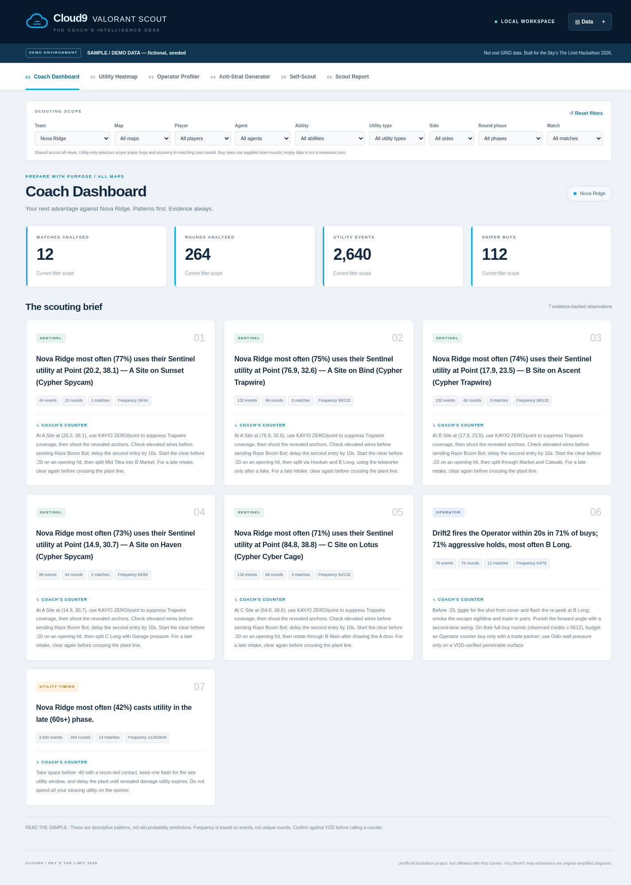
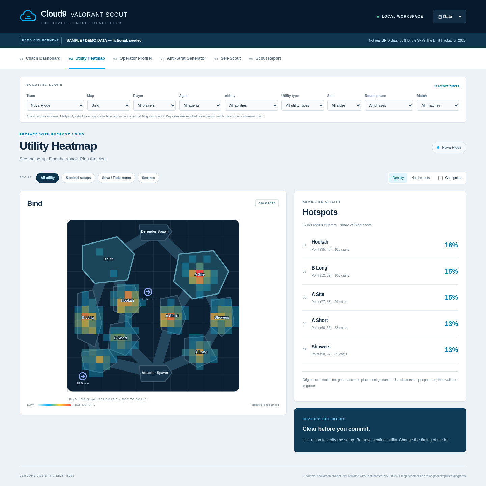
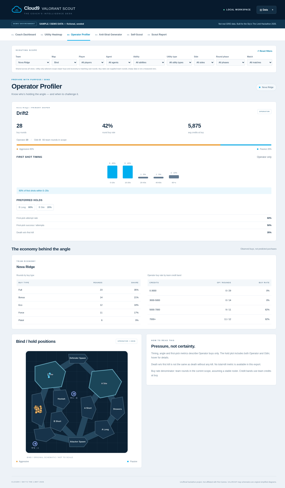
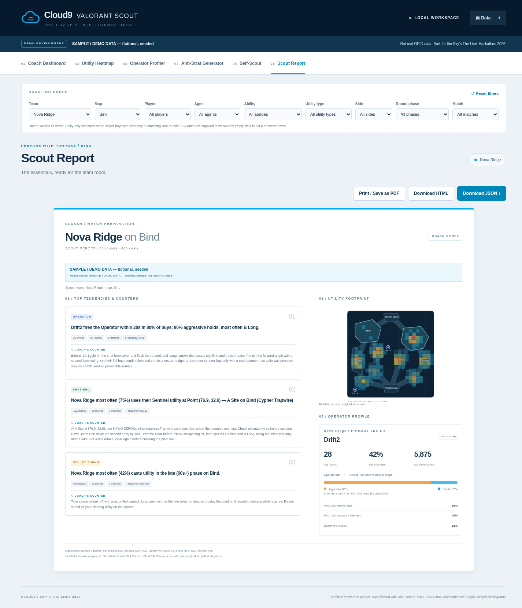
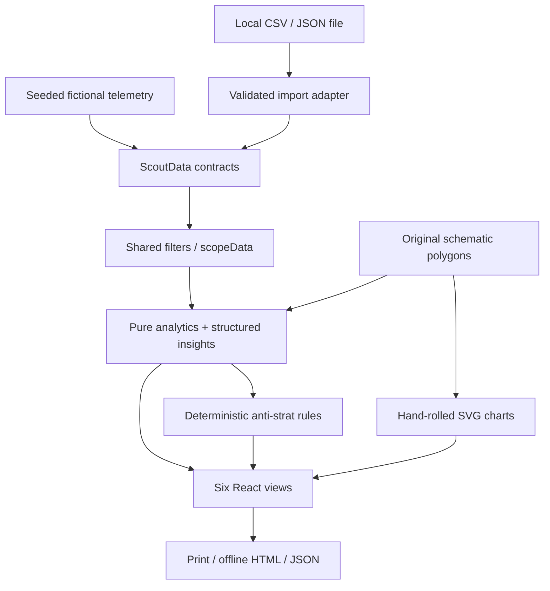

# Cloud9 VALORANT Scout

Cloud9 x JetBrains Sky’s The Limit Hackathon 2026 · Category 1: VALORANT Tactical Scouting, Utility Placement & Operator Profiler.

**SAMPLE / DEMO DATA — fictional, seeded, not real GRID data.** All handles, matches and tendencies are synthetic. No backend, authentication, API keys or runtime network calls. Six coach-facing views share a lifted filter state: Dashboard, Utility Heatmap, Operator Profiler, Anti-Strat Generator, Self-Scout and Scout Report.

## Run

Use **Node.js 22** and npm. With nvm, first run `source ~/.nvm/nvm.sh && nvm use 22` (install Node 22 with nvm if needed).

```sh
npm install
npm run dev
```

Open the local Vite URL printed in the terminal (normally http://localhost:5173). The app runs entirely in the browser. A normal session needs no accounts, keys or internet access once dependencies and assets are installed. Data is held in memory; reload restores the sample.

```sh
npm test
npm run build
npm run preview
```

Build output is `dist/`; Vite uses `base: './'` for relative asset paths. `npm ci` is the reproducible alternative to `npm install` with the committed lockfile. Preview normally uses http://localhost:4173.

For browser verification, first build and keep `npm run preview -- --port 4173 --host` running; in a second terminal:

```sh
npm run e2e
```

Install a local Google Chrome separately or set `CHROME_PATH` to an existing Chromium-compatible executable. `playwright-core` does not install a browser. The smoke script uses `which google-chrome` as its Unix default; on Windows/macOS set `CHROME_PATH` explicitly. Both dev and preview listen on all interfaces by default: run only in a trusted local environment.

## What it does

| View | Coach-facing result |
| --- | --- |
| **Coach Dashboard** | Current-scope matches, rounds and casts; evidence-backed observations and corresponding counters. |
| **Utility Heatmap** | Distinct original Ascent, Bind, Haven, Lotus and Sunset schematics; 24×24 density or 12×12 hard counts, individual casts, radius hotspots and Sentinel/recon/smoke quick filters. |
| **Operator Profiler** | Per-player buy frequency, credits, Operator/Odin counts, early-shot timing, aggressive/passive holds, first-pick outcomes, economy bands and a hold map. |
| **Anti-Strat Generator** | Deterministic clears, alternate routes, timing changes and counter-buy suggestions using structured agent/ability/zone/credit context, with supporting counts separate from the advice. |
| **Self-Scout** | The same evidence and rules applied to fictional Cloud9 players to expose predictable own-team habits. |
| **Scout Report** | Opponent/map brief with top tendencies, Operator profile, counters and mini heatmap; print/save PDF, self-contained HTML and JSON downloads. |

All six views share team, map, player, agent, ability, utility type, side, phase and match filters. The **Data** panel loads a local CSV/JSON file and resets to the sample without contacting a server.

### Why Category 1?

**VALORANT Tactical Scouting, Utility Placement & Operator Profiler** directly matches the coaching loop this project demonstrates: observe a repeated setup, understand the sniper/economy context, choose a concrete counter and take a compact brief into preparation. The prototype favors explainable frequencies and evidence chips over opaque predictions. The same loop powers opponent analysis and self-scouting. This is an entry prototype, not a claim of competitive results or an official Cloud9 scouting system.

## Screenshots

Current seeded-demo captures, generated by the CDP smoke test. The four losslessly compressed PNGs are approximately 185–285 KB each. They show fictional telemetry, not real team performance.

### Coach Dashboard


### Utility Heatmap


### Operator Profiler


### Scout Report


## UI integration contract

- `src/data/sampleData.ts`: `sampleData`, `generateSampleData(seed = 2026)`, `TEAMS`, `ROSTERS`, `DATA_SOURCE_LABEL`. 24 matches, 528 rounds, 10,560 ability casts; four teams of five fictional players. Generated only at import, deterministically.
- `src/lib/types.ts`: data interfaces, `Filters`, `Insight`, `AntiStrat`, `phaseAt`. Every match, round and event carries `dataLabel`, as does its dataset. Phase boundaries are [0,20), [20,60), [60,infinity); post-plant flag is not modeled separately.
- `src/lib/maps.ts`: `MAPS[map]` provides original schematic site/callout/spawn/lane polygons (not real layouts or Riot art); `zoneAt(map,x,y)` names a containing zone. SVG coordinate space is 0–100.
- `filterEvents(events, filters)` supports undefined/`all` selectors. `heatmapGrid(events, cols=10, rows=10)` returns cells with count/density. `clusterHotspots(events, radius=8)` greedily selects dense radius neighborhoods per map; share is percent of input events, not rounds.
- `tendencyPercentages(events, keyFn)` returns `{total, items:[{key,count,pct}]}`. Percentages are unrounded numbers; format in the UI.
- `sentinelSetupTendencies(abilityEvents, radius=8)` groups by team/map and uses Sentinel-role casts (including their damage utility), reporting the strongest cluster plus evidence counts.
- `operatorStats(sniperEvents, rounds)` returns `{players,teams}`. Weapon counts include Operator and Odin; angle, timing, pick and hold metrics refer to Operator only. Buy rate is unique buy rounds / team rounds supplied, assuming a stable five-player roster. Credit bands use the team's pre-buy credits, not remaining credits. Timing buckets are left-inclusive/right-exclusive. `deathWithoutKillRate` is a **proxy: death without a first kill**, because this telemetry has no total-kills field. Do not label it as full kill-trade efficiency.
- `generateInsights(data, team, map?)`, `generateAntiStrats(insights)`, `selfScout(data, team='Cloud9')`, and `buildScoutReport(data, opponent, map?)` are pure and deterministic. The report is JSON serializable and carries its data label. Evidence covers observed events/rounds/matches, not causal claims. Top three can contain fewer than three entries if evidence is limited.

## Import adapter

`loadData(text, 'csv'|'json', dataLabel?)` returns `{data,errors}`; valid rows are retained and invalid rows yield numbered errors. Check `errors` before replacing a workspace. Default provenance is `IMPORTED DATA — source unverified`; pass `DATA_SOURCE_LABEL` explicitly when loading the demo CSV. No automatic connection to GRID is implied. Provider exports need mapping to this documented flat schema; arbitrary native GRID formats are not supported.

CSV requires an `eventType` column (`ability`, `sniper`, `round`, `match`) and columns named exactly as the matching TypeScript interface. `dataLabel` is assigned from the loader argument, and ability `phase` is derived. Round `economy` is a CSV-escaped JSON object keyed by team; match rounds are reconstructed from the round rows. JSON accepts either an array of records with `eventType`, or a full ScoutData object. Separate match/round records are needed for economy and buy-rate denominators. A ten-row ability example is in `public/sample-grid-export.csv` (demo only, not a complete match). Malformed columns, enums, numbers, booleans, coordinates and JSON/CSV syntax are reported rather than silently guessed.

### Replacing sample data with a permitted GRID export

1. Obtain authorized telemetry and confirm the provider's licensing/privacy constraints. **There is no GRID SDK, API integration, credential flow or automatic native-format detection here.** Do not commit private exports.
2. Write an offline adapter to the columns below. Normalize and align each map into this project's 0–100 SVG coordinate frame; simply dividing raw world coordinates is not enough. Use consistent team/player IDs across streams, a single match/round key and seconds elapsed since round start. Supply verified hold-zone/angle annotations; the loader does not infer them.
3. Export CSV or JSON using the exact case-sensitive names. In mixed CSV files use the union of these columns and leave fields for other event types blank. Required columns/values per row:

```text
ability: eventType,eventId,matchId,roundNumber,map,team,player,agent,ability,abilityType,agentRole,side,x,y,roundTimeSec
sniper: eventType,matchId,roundNumber,map,team,player,weapon,credits,side,holdX,holdY,holdZone,angleType,firstShotTimeSec,gotFirstKill,died,firstPick
round: eventType,matchId,roundNumber,map,attackingTeam,defendingTeam,winner,economy
match: eventType,matchId,date,map,teamA,teamB,winner
```

`eventType` is the singular token before each colon, not a literal column prefix. `phase` is calculated (`<20`, `<60`, otherwise late); a supplied `phase` is overwritten. `dataLabel` on rows is also overwritten by the loader's provenance argument, defaulting to `IMPORTED DATA — source unverified`. CSV booleans must be `true`/`false`; numbers must be finite; coordinates must be 0–100; rounds are positive integers. Supported maps and enums, nested economy encoding, full JSON examples and all model fields are in [Methodology — data contract](docs/METHODOLOGY.md#data-contract).

For example, a JSON flat-record file can start with:

```json
[
  {
    "eventType": "ability", "eventId": "example-1", "matchId": "m1",
    "roundNumber": 1, "map": "Ascent", "team": "Opponent", "player": "Player1",
    "agent": "Killjoy", "ability": "Turret", "abilityType": "sentinel",
    "agentRole": "Sentinel", "side": "defense", "x": 18.8, "y": 22.6,
    "roundTimeSec": 5
  }
]
```

4. Open **Data → Choose CSV / JSON** and select the local file. The UI refuses to replace the current workspace if any validation errors are returned; fix the reported rows and retry. An ability-only file gives utility observations but no trustworthy economy/buy-rate denominator. Load match and round rows plus sniper rows for the full workspace. No file upload or persistence occurs.
5. For a bundled replacement, put an authorized, reviewed `ScoutData` fixture under `src/data/`, validate it through `loadData`, and replace the `sampleData` import in `src/App.tsx`. Keep provenance accurate on the dataset and every record. The prototype deliberately retains its demo-environment banner even for imports; removing it for a production integration would require a separately reviewed provenance/UI change.

Validation is structural, not a complete provider audit: it does not deduplicate records, verify referential integrity across streams, validate actual ability semantics or prove the origin of a file. Reconcile IDs, teams, rounds, timing and economy units in the adapter before trusting a brief.

## Scouting workspace

The sample badge stays visible on every view; the active import provenance is shown separately and exported. Filters apply across the app. Player/agent/ability options narrow by team and map; changing either clears dependent selectors. Self-Scout selects Cloud9, and leaving it restores the previous opponent. If an imported dataset has no Cloud9 records, self-scouting explicitly shows no observations.

`src/lib/workspace.ts` provides `scopeData(data, filters)` and `workspaceAnalysis(scopedData, team, map?)`. Ability-only filters join sniper buys and economy to matching cast rounds, rather than pretending a weapon buy has an agent or ability attribute. Side filters use the selected team's attacking/defending rounds. A utility timing observation supplements sentinel and Operator insights, so the standard map-level sample brief has at least three observations. Sparse slices honestly show fewer; no placeholder insights are invented.

The Data panel uses `loadData` and applies an import only when there are no errors. Reset restores the seeded sample. The included ten-row CSV has no match/round metadata or sniper buys: utility views work, while economy and sniper data remain unavailable.

Scout Report follows the shared filters and uses a dedicated report-map selector only when global map is `all`. HTML exports contain inline CSS and SVG with no scripts, fonts, images or remote dependencies. JSON exports include the current scope and provenance. Print CSS hides the workspace chrome and formats the report for A4. `src/lib/export.ts` contains the download helpers.

## Browser verification

Run `npm run build`, keep `npm run preview -- --port 4173 --host` running, then run `npm run e2e` in another shell. The smoke script launches system Google Chrome headless, connects over CDP using `playwright-core`, compares heatmap cell-count arrays after team/map changes, exercises chart toggles and empty states, verifies Operator profiles, downloads HTML/JSON, renders the standalone HTML without network requests, checks print output is a single A4 page, exercises import validation/reset and checks mobile overflow and browser console errors. It captures each view plus report/import/mobile evidence.

Environment overrides: `CHROME_PATH` (default: `google-chrome` from PATH), `BASE_URL` (default: `http://127.0.0.1:4173`), `SHOTS_DIR` (default: `~/shots`). Screenshots and export artifacts are outside the repository. No browser binaries are downloaded.

## Architecture and files



| Path | Responsibility |
| --- | --- |
| `src/data/sampleData.ts` | Seeded PRNG, fictional rosters, map/team zone plans and coherent coordinates. |
| `src/lib/types.ts`, `maps.ts` | Telemetry/evidence contracts; original map geometry, named zones and features. |
| `src/lib/analytics.ts` | Pure aggregation, clustering, Operator statistics, insights and rule-based counters. |
| `src/lib/workspace.ts` | Cross-stream filter joins and per-team workspace analysis. |
| `src/lib/dataLoader.ts` | Local CSV/JSON parsing and row validation; no provider connectivity. |
| `src/App.tsx`, `src/components/` | Lifted workspace state, six views, SVG charts and profile/insight cards. |
| `src/styles.css`, `src/report.css`, `src/lib/export.ts` | Responsive design, A4 print rules and offline exports. |
| `src/lib/*.test.ts` | Analytics, import, scope, export, realism and project-setup regression tests. |
| `scripts/e2e-smoke.mjs` | Headless Chrome/CDP checks, screenshots and export evidence. |
| `.idea/runConfigurations/`, `.editorconfig`, `.junie/` | Portable JetBrains npm configurations and project conventions. |
| `docs/METHODOLOGY.md`, `docs/AI-WORKFLOW-STORY.md` | Formulas, limitations and an honest AI/JetBrains workflow handoff. |

No backend, database, authentication, tracking, chart framework, external font or runtime API is used. React and React DOM are the runtime dependencies; Vite/TypeScript/Vitest and `playwright-core` support development and verification.

## Testing and interpretation

`npm test` runs Vitest: hand-built percentage/timing fixtures, empty inputs, filter behavior, seeded generation, CSV/JSON errors, provenance, report escaping/styles, map polygons and features, map/team placement variation, specific anti-strat branches and shared project configuration contracts. `npm run build` runs strict TypeScript checking and creates the production bundle. `npm run e2e` checks the rendered production preview, downloads and print output, not tactical correctness.

Density colors are relative to the busiest cell in the current slice, not calibrated risk. Hotspot frequency counts **casts**, not rounds; repeated utility can overweight a setup. Sniper buy-rate denominators assume stable rosters. The “death w/o first kill” field is intentionally a proxy and is not a total-kill or trade metric. No minimum-sample confidence gate is enforced: a tiny valid slice may still produce an observation. Always inspect its evidence and validate the plan against VOD and the current patch. See [Methodology](docs/METHODOLOGY.md) for exact formulas, thresholds and limitations.

## Free static deployment

Deployment is optional and has **not** been performed by this repository setup. Free-tier terms can change. Deploy only the intended public demo; never bundle private telemetry. There are no environment secrets to configure, and navigation is in-page so no SPA rewrite is required.

### Vercel
1. Import `https://github.com/ZQ051031/cloud9-jetbrains-2026` as a new project.
2. Select the Vite preset, Node 22, repository root, build command `npm run build` and output directory `dist` (install: `npm ci`).
3. Deploy using an eligible free plan. Open the generated URL, verify all six views and report download/print, then use that verified URL in the submission. No hosted demo URL is claimed here.

### Netlify
1. Add a site from the same repository, using a free plan if eligible.
2. Leave base directory at the repository root, use Node 22, build `npm run build`, publish `dist`; do not add backend functions or secrets.
3. Deploy and verify the assigned URL. Alternatively, build locally and upload only `dist/` with Netlify's manual-deploy interface.

### GitHub Pages (manual only)
1. In repository **Settings → Pages**, choose **GitHub Actions** as the build/deployment source. Confirm Pages is allowed for the repository/account.
2. The included [Pages workflow](.github/workflows/pages.yml) has **only `workflow_dispatch`**: pushing commits does not publish or trigger it. In **Actions → Deploy demo to GitHub Pages (manual) → Run workflow**, choose `main` and run it yourself.
3. It installs from the lockfile on Node 22, builds `dist/` and deploys through the `github-pages` environment. Approve any required environment protection prompt.
4. Use the URL in the deployment output (normally `https://zq051031.github.io/cloud9-jetbrains-2026/`) only after a successful run and browser verification. `base: './'` supports the repository subpath. If it fails, check Pages permissions/source and the workflow logs; no force-push or custom domain is needed.

## JetBrains-tool usage story

**Initial code was generated by Devin, the Cognition AI software engineering agent. Devin did not use a JetBrains IDE in this implementation.** Providing IDE files does not establish JetBrains-tool usage or bonus eligibility.

The intended follow-through is for the entrant to open the repository in **WebStorm** or **IntelliJ IDEA** with JavaScript/TypeScript support, select Node 22, run the included `Cloud9: dev/test/build/preview/e2e` npm configurations, and actually finish/iterate the project there. The preview configuration uses port 4173; run it before e2e. Other `.idea` state remains ignored, so local SDK paths and workspace history are not committed.

Use **Junie** for a focused follow-up improvement and review its diff/tests. Where available, try **JetBrains Air** for a separate bounded task and record the exact product, version and outcome. These are proposed next actions, **not completed sessions**. Do not claim tools were used if they were not. The entrant must document the real session(s), prompts, changed files and screenshots in [the workflow case study and TODO session log](docs/AI-WORKFLOW-STORY.md). Check the hackathon's current tool-use and bonus requirements before submission.

## Devpost submission checklist

- [ ] **Working demo link:** TODO — deploy and paste a verified public URL. The project is not hosted merely because the repository is public.
- [ ] **Public repository:** https://github.com/ZQ051031/cloud9-jetbrains-2026 — verify anonymous read access before submitting.
- [ ] **≤3-minute YouTube demo:** TODO — the entrant records and uploads it. Show the sample notice, one map/team filter change, a Sentinel clear, an Operator counter and the exported report; include actual JetBrains work only if performed.
- [ ] **Methodology write-up:** [docs/METHODOLOGY.md](docs/METHODOLOGY.md) ([public repository link](https://github.com/ZQ051031/cloud9-jetbrains-2026/blob/main/docs/METHODOLOGY.md)).
- [ ] **AI-powered workflow story:** complete [docs/AI-WORKFLOW-STORY.md](docs/AI-WORKFLOW-STORY.md) with genuine WebStorm/IntelliJ, Junie and/or Air evidence, replacing TODOs without inventing usage.
- [ ] Confirm Category 1 selection, current eligibility/rules, attribution and demo-data disclosure. Re-run the local checks after any follow-up changes.

## Disclaimer and license

Unofficial hackathon project. **Not affiliated with or endorsed by Riot Games, Cloud9, GRID or JetBrains.** VALORANT, team, product, map, agent and ability names belong to their respective owners. The cloud icon is a generic original design, not the Cloud9 trademark logo. Map schematics are original simplified diagrams, not Riot artwork, accurate in-game layouts or placement guides. All bundled matches, players, positions and tendencies are fictional; no real GRID data is included. Rules are coaching discussion prompts, not guaranteed tactical recommendations.

Code and original project material are available under the [MIT License](LICENSE), `SPDX-License-Identifier: MIT`, copyright 2026 ZQ051031. Third-party trademarks are not licensed by this grant.
